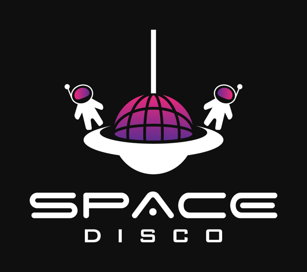

<p align="center">
  
</p>

<h1 align="center">spacedisco.com-threejs</h1>

<p align="center"><strong>spacedisco.com: the scrolling Three.js mirror-ball landing page for the Orbital Lounge and House Music Club.</strong></p>

<p align="center"><em>"We are going to space and we are bringing a disco."</em> 🚀🪩</p>

> **Status:** Dormant since Aug 20, 2022. · **Visibility:** public · **Language:** JavaScript · **History:** 2021-05-21 → 2022-08-20, 2 commits

## 🪩 What this is

Fireship's scrollable Three.js demo customized for Space Disco: rotating disco balls behind the mission copy ("We are going to space and we are bringing a disco"), crew members, events, and resident DJ ZYLER, with a 2020 event highlight video.

## 🎛️ Stack

- Vite
- three.js
- gsap
- Typekit fonts (brandon-grotesque, elevon)

## 🗺️ Layout

| Path | What it does |
| --- | --- |
| `index.html` | copy and sections |
| `main.js` | scene, scroll animation |
| `src/disco_balls.js, mirror_balls.js, mirror-balls.html` | mirror-ball experiments |
| `style.css` | dark panels over the canvas |
| `space_disco_2020_highlight_1080p.mp4` | 50 MB highlight video committed to git |
| `favicon.svg` | site icon |

## 🚀 Launch sequence (local setup)

```bash
npm install
npm run dev
npm run build   # outputs dist/
```

## 🛸 Deploy

Static Vite build; no deploy config in the repo. The live spacedisco.com today serves a different site.

## 🔌 Integrations

Typekit, SoundCloud link to soundcloud.com/zylerdj.

## 🧪 Tests & CI

None.

## 🛰️ Current state

Dormant since Aug 20, 2022. The live spacedisco.com is not built from this repo.

## 🌌 How it connects

Brand source of truth for Space Disco copy and tone.

## 🙏 Credits

Based on the Fireship [scrollable Three.js animation](https://fireship.io/snippets/threejs-scrollbar-animation) demo by Jeff Delaney.

---

<p align="center"><sub>Space Disco · Orbital Lounge and House Music Club · Deep, Minimal, Tech House &amp; Soulful, Groovy, Funky, Disco House.<br>Documentation refreshed November 2026 from a read of the code and history.</sub></p>
